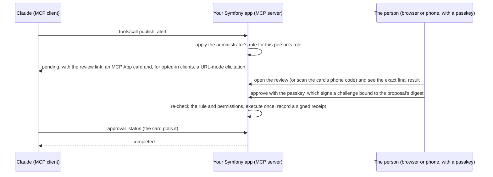

# Verified Human Approval

**Let an AI agent ask your Symfony application for a high-stakes action. The application will not carry it out until the right person has approved that exact action with their passkey.**

Verified Human Approval is a Symfony bundle, with framework-neutral packages behind it, for applications that expose actions to agents through MCP. An agent such as Claude calls one of your MCP tools. Your application applies its administrator's rule for that person's role: act directly, verify first, or not at all. When the person must verify, the application freezes the exact proposal and shows it in Claude as an approval card or a native prompt. The person reviews the final result on your own site and approves with a passkey: Touch ID on a Mac, or Face ID on their phone after scanning a code in the card. The application then re-checks the rule and their permissions and makes that stored change once.

**The application enforces this.** Not MCP, not the agent, and not a judgment call in the chat. The rule lives in the application and covers every way in: its own website, any MCP client, any agent. Only the person's passkey, signing the exact proposal, satisfies it. A client saying "accept" never counts as approval, and nothing the agent sends later can change what was approved.

Built with the official PHP MCP SDK (`mcp/sdk`), the Symfony MCP bundle and Symfony AI, on the MCP standard as it is: MCP Apps for the card, URL-mode elicitation for the native prompt and OAuth for remote clients.

## Install

```bash
composer require verified-human-approval/symfony-bundle verified-human-approval/webauthn
```

The packages are not on Packagist yet. Until they are, install them from a checkout of this repository next to your application:

```bash
git clone https://github.com/scottfalconer/verified-human-approval.git ../verified-human-approval
composer config minimum-stability dev
composer config prefer-stable true
composer config repositories.verified-human-approval path '../verified-human-approval/src/*'
composer require verified-human-approval/symfony-bundle:dev-main verified-human-approval/webauthn:dev-main
```

You need PHP 8.3+ with `pdo`, `sodium` and `openssl`, a Symfony 7.4+ application with SecurityBundle and TwigBundle, and the Symfony MCP bundle (`symfony/mcp-bundle`), which serves your MCP endpoint.

## Configure

Register the bundle beside the MCP bundle (Symfony Flex does this for you):

```php
// config/bundles.php
return [
    // ...
    Symfony\AI\McpBundle\McpBundle::class => ['all' => true],
    VerifiedHumanApproval\Bundle\VerifiedHumanApprovalBundle::class => ['all' => true],
];
```

Name the services that connect it to your application. These are service ids you choose, never request data:

```yaml
# config/packages/verified_human_approval.yaml
verified_human_approval:
    public_origin: '%env(APP_ORIGIN)%'                        # review links are built from this, never from request headers
    actor_provider: App\Approval\ApplicationActorProvider     # who is asking, and who the signed-in person is
    policy_provider: App\Approval\ApplicationPolicyProvider   # the administrator's rule, per role
    authorizer: App\Approval\CurrentAuthority                 # the person's permissions, re-checked as the action executes
    store: VerifiedHumanApproval\Core\Storage\PdoApprovalStore
    verifier: VerifiedHumanApproval\WebAuthn\WebAuthnVerifier
    receipt_signer: VerifiedHumanApproval\Core\Evidence\SodiumEvidenceSigner   # signs each execution's receipt in the same transaction
    requester_label: App\Approval\AgentConnectionLabel                         # optional: names the agent connection on the review page
    attempts_per_minute: 30
```

```yaml
# config/routes/verified_human_approval.yaml
verified_human_approval:
    resource: '@VerifiedHumanApprovalBundle/config/routes.php'
```

```yaml
# config/packages/mcp.yaml
mcp:
    servers:
        application:
            http:
                path: /mcp
                allowed_hosts: ['app.example.com']
            registry:
                tools:
                    - App\Mcp\PublishAlertTool
                    - VerifiedHumanApproval\Bundle\Mcp\ApprovalStatusTool
                    - VerifiedHumanApproval\Bundle\Mcp\ApprovalHandoffTool   # the card's phone code; hosts hide it from the model
                apps:
                    - VerifiedHumanApproval\Bundle\Mcp\ApprovalCardApp
            session:
                lock: { enabled: true }                 # the card polls while the model calls tools
            request_state:
                key: '%env(MCP_REQUEST_STATE_KEY)%'     # signs the URL prompt's retry; its own key, 32+ bytes
                ttl: 900                                # longer than your approval lifetime, so a late retry still reads the outcome
```

Put the review routes (`/approval/…`) behind your normal session firewall, and keep a separate stateless firewall for `/mcp`, authenticated per person with a token from your OAuth server or a personal token. An agent's token must never count as a signed-in person. The review pages open without a sign-in, so a one-time phone code can open one review on a phone; the bundle's controller then requires the signed-in person or that scoped session, and its request matcher lets exactly those routes through:

```yaml
# config/packages/security.yaml
security:
    access_control:
        - { request_matcher: verified_human_approval.review_request_matcher, roles: PUBLIC_ACCESS }
```

Publish the review page's script and stylesheet with `php bin/console assets:install` (Symfony Flex does it after `composer install`). The demo's [kernel](demo/src/DemoKernel.php) shows the two firewalls and the rest of the wiring.

## Use it

**Say who is asking.** Implement `VerifiedHumanApproval\Bundle\ActorProvider`. `current()` derives the actor from the authenticated Symfony principal, the person behind the agent's token. `interactive()` returns the signed-in person and must refuse an agent credential. `assertCanReadApproval()` checks the current read grant before a stored result is shown. Nothing reads a claimed user id from tool arguments.

**Wrap the tool.** A protected tool is an ordinary SDK tool that asks the approval service instead of acting:

```php
use VerifiedHumanApproval\Bundle\ActorProvider;
use VerifiedHumanApproval\Core\ApprovalService;
use VerifiedHumanApproval\Core\ApprovalState;
use VerifiedHumanApproval\Mcp\ApprovalCard;
use VerifiedHumanApproval\Mcp\ApprovalFlow;
use Mcp\Capability\Attribute\McpTool;
use Mcp\Schema\Result\CallToolResult;
use Mcp\Schema\Result\InputRequiredResult;
use Mcp\Server\RequestContext;

final readonly class PublishAlertTool
{
    public function __construct(
        private ApprovalService $approvals,
        private ActorProvider $actors,
        private ApprovalFlow $flow,
    ) {}

    #[McpTool(name: 'publish_alert', meta: ApprovalCard::TOOL_META)]
    public function publish(RequestContext $context, string $alert_id, ?string $request_key = null): CallToolResult|InputRequiredResult
    {
        $actor = $this->actors->current();

        // The card's result, or for an opted-in client a URL-mode elicitation. Either way the person approves on your site.
        return $this->flow->respond(
            $context, $actor, 'publish_alert', ['alert_id' => $alert_id, 'request_key' => $request_key],
            fn (): ApprovalState => $this->approvals->request($actor, 'alert.publish', ['alert_id' => $alert_id], $request_key),
        );
    }
}
```

A pending approval is a normal tool result, not an error. It carries `requestId`, `status`, `review_url` and the card's view; the agent reads the outcome later with `approval_status`. The HTTP request is never held open while the person reads the page.

**Register the action and guard its mutation.** Implement `VerifiedHumanApproval\Core\ActionAdapter`: `prepare()` freezes the exact effect (the content, the version of the code that renders it, preconditions such as the current revision), `assertPreconditions()` and `assertPostconditions()` check it before and after, and `execute()` applies it. Then make every code path that performs the mutation call `ExecutionGuard::assertExecuting()` first. That context exists only while the core applies a validated stored proposal, in one database transaction with consuming the approval, updating the passkey's counter and recording the signed receipt. Your website and your MCP tool both enter through `ApprovalService`.

**Passkeys.** `WebAuthnVerifier` verifies assertions with user verification required, bound to your origin and RP ID and to the proposal's digest. Enrollment belongs to your trusted account flow, and a password alone must not be enough for it: the demo issues one-time links for the first passkey and requires an existing passkey for any further one. Wrap your credential repository in `AnchoredCredentialRepository` so that only a passkey with a signed enrollment record in the audit log can approve.

**The card, the native prompt and the phone.** Hosts that implement MCP Apps, such as Claude Desktop and claude.ai, show the approval card. It opens the review through `ui/open-link` or, when `public_origin` is HTTPS, shows a one-time code that opens that one review on the person's phone. Clients you list under `url_elicitation.clients` also get a URL-mode elicitation on MCP 2026-07-28, with a retry bound to the same caller, tool and arguments. Every client gets a plain link.

```yaml
verified_human_approval:
    url_elicitation: { enabled: true, clients: ['claude-code'] }
```

The full integration guide, including evidence export and the review templates, is in [src/symfony-bundle/docs/index.md](src/symfony-bundle/docs/index.md).

## What the application guarantees



- **The administrator sets the rule, per role.** It says which roles act directly, which must verify each exact change, and which may not act. Every proposal records the rule's version, so changing the rule invalidates pending requests. Changing the rule can itself be an approved action.
- **A password is not a passkey.** Only a passkey with a signed enrollment record can approve, and the application decides who may enroll one.
- **The proposal is frozen.** It holds the exact content, the renderer's version, who asked, the rule and an expiry, all stored as canonical JSON with a SHA-256 digest.
- **The person sees the real result.** The review page renders your own template from the frozen proposal, not from the current draft.
- **The application acts, not the client.** Completing the passkey ceremony runs the stored proposal in one database transaction, together with consuming the approval and recording a receipt signed with the application's key.
- **Every record can be checked.** Receipts are signed as the action commits, with a key kept outside the database. An audit page can re-check each one, and re-check the person's passkey signature against the key they enrolled. Evidence bundles verify offline with `verify-evidence.php`.
- **Each client gets the way it can show.** An MCP App card (`io.modelcontextprotocol/ui`) for hosts that render apps, a URL-mode elicitation for clients you opt in, and a plain link for every client.
- **Remote clients sign in with MCP OAuth.** The bundle leaves the authorization server to you or to a dedicated bundle; it needs a firewall that identifies the person behind each token. An agent's token can ask for an action. It can never approve one.

## What it refuses

| Attempt | Result |
| --- | --- |
| A staff member's agent asks to issue the alert | Pending until that person approves with their passkey. The agent can't skip it |
| A read-only colleague's agent asks | Refused: the rule doesn't let that role issue alerts |
| The administrator changes the rule while a request waits | That request can no longer be approved |
| The draft is edited after you reviewed it | Not issued: the proposal no longer matches |
| The alerts page layout changes after review | Not issued: the layout is part of what you approved |
| A signed approval is replayed for another request | Rejected: the signature covers one proposal's digest |
| A client answers "accept" without your passkey | Still pending: accept only means the page was opened |
| The same approval is repeated | The same receipt, and the alert issued once |
| A phone code is used twice, or after two minutes | Refused: each code works once |
| Someone with only the password tries to add a passkey | Refused: the first needs a one-time link, any other an existing passkey |
| A passkey row is added or changed directly in the database | It approves nothing: no signed enrollment record vouches for it |
| An approval's record is edited in the database afterwards | The audit page's checks fail: the receipt was signed at commit, and the passkey signed the original |
| An administrator's password alone tries to switch verification off | Pending: the rule change waits for the administrator's passkey |
| Another account, or a read-only agent token | No access to the request, and no rights from a passkey |

Each row is a test in [tests](tests).

## Packages

| Package | What it does |
| --- | --- |
| [`verified-human-approval/symfony-bundle`](src/symfony-bundle) | The Symfony bundle: configuration, review routes, CSRF, rate limits, the card app, the phone code and the status tool |
| [`verified-human-approval/core`](src/core) | Frozen proposals, policies, current authority, guarded single execution, receipts signed at commit, the signed audit log and evidence verification. No framework dependency |
| [`verified-human-approval/webauthn`](src/webauthn) | Passkey enrollment, assertion verification bound to the proposal, and passkeys anchored to signed enrollment records |
| [`verified-human-approval/mcp`](src/mcp) | The MCP App approval card, the opt-in URL-mode elicitation and its bound retry |

This repository holds them together, like `symfony/ai`: the root `composer.json` replaces the four packages, so the demo and the tests run from a checkout.

## The demo and the examples

[`demo/`](demo/README.md) is Riverside Council's public alerts site: a complete Symfony application using the bundle, with per-role rules, passkey links, an audit page and a stand-in OAuth server for claude.ai. Its README has the five-minute quickstart, the claude.ai and phone walkthrough, and a map of where each part of the integration lives. [`examples/`](examples) has the clients that drive it over real MCP: `mcp.php` with the official SDK client, and `agent.php` with Symfony AI's `Agent` and `McpToolbox`.

## Built with

- **The PHP MCP SDK 0.9** serves both protocol eras from one server: the 2025-11-25 handshake and the 2026-07-28 multi round-trip, with signed request state, URL-mode elicitation, the MCP Apps extension and OAuth protected resource metadata.
- **The Symfony MCP bundle's `#[AsMcpApp]`** serves the approval card, and `_meta.ui` links ordinary `#[McpTool]` tools to it, including the phone-code tool that conforming hosts hide from the model. Tools receive the SDK's `RequestContext`, with the validated token and its scopes.
- **Symfony AI's Agent and McpToolbox** drive the same tools in a scripted example: `php examples/agent.php --scripted`.
- **`web-auth/webauthn-lib`** verifies passkeys with user verification required.

## Tests

```bash
composer test        # PHPUnit: core, WebAuthn, the bundle, MCP, OAuth, the phone code and evidence
composer analyse     # PHPStan
PHP_BIN=php python3 tests/http_smoke.py   # the real demo and the official SDK client over HTTP
```

Optional checks that drive real clients. The browser checks need Python Playwright, and `CHROMIUM_BIN` set to Chrome or Chromium:

- **`tests/browser_smoke.py`** runs real Chrome against the real page scripts, with a virtual passkey.
- **`tests/card_smoke.py`** runs the real approval card in Chrome inside a scripted MCP Apps host, and reads the QR code it draws with a real decoder.
- **`tests/phone_smoke.py`** approves on a "phone": a separate browser that never signed in, behind a stand-in HTTPS tunnel, using a synced copy of the passkey.
- **`tests/claude_code_host.py`** runs the real Claude Code engine, the way the Claude desktop app does. It checks that the native prompt reaches the host, and that after approval the retried call returns the recorded result. It makes one small model call.

## Status

Verified on a Mac with PHP 8.3:
- the PHPUnit suite and PHPStan;
- the HTTP smoke test;
- Chrome with virtual passkeys: the approval flow, the card's phone code, and a phone approval behind a stand-in HTTPS tunnel;
- Claude Code 2.1.317's native prompt end to end;
- the whole flow in a real Claude Desktop chat with Touch ID, on the earlier announcement version of the demo: the card appeared, the review page showed the final page, an iCloud Keychain passkey approved it, the site published once, and the card picked up the result;
- claude.ai through a Cloudflare quick tunnel, with a physical iPhone: claude.ai signed in through the demo's OAuth using Claude's published identity, the card in claude.ai showed the phone code, and the iPhone, never signed in, approved with the synced passkey. The alert was issued once.

Not yet covered: production identity integration, and databases other than SQLite.

See the [full overview](docs/overview.md), the [security model](docs/security-model.md), [evidence verification](docs/evidence.md) and the [conformance review](docs/conformance-review.md) of how this uses the SDK, the bundle and the MCP specification.

MIT license. See [LICENSE](LICENSE).
