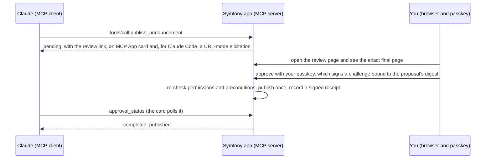

# Exact Approval

**An AI agent can ask to publish. Only your passkey can make it happen, and you approve the exact page that goes live.**

An agent, such as Claude, prepares a change through MCP. The Symfony application freezes that exact proposal and shows it to you in Claude as an approval card or a native prompt. You review the final page on the application's own site and approve with a passkey, such as Touch ID. The application then re-checks your permissions and publishes that stored proposal once. A client saying "accept" never counts as approval, and nothing the agent sends later can change what you approved.

Built with the official PHP MCP SDK (`mcp/sdk`), the Symfony MCP bundle and Symfony AI, on the MCP standard as it is: MCP Apps for the card and URL-mode elicitation for the native prompt.

## Run it in five minutes

You need PHP 8.3+ with the `pdo_sqlite`, `sodium` and `openssl` extensions, Composer, and Chrome or Safari. To see the Claude side, you also need Claude Desktop or Claude Code.

```bash
git clone https://github.com/scottfalconer/exact-action-approval.git
cd exact-action-approval
composer install
php examples/symfony/bin/setup.php
PHP_CLI_SERVER_WORKERS=4 php -S localhost:8080 -t examples/symfony/public examples/symfony/public/index.php
```

Setup prints fresh passwords and personal agent tokens once, plus the exact commands for connecting Claude. The server runs several workers because Claude keeps a connection open while you approve in the browser. Then:

1. **Add a passkey.** Open http://localhost:8080, sign in as `editor`, and open **Your passkeys**. On a Mac, Touch ID works.
2. **Connect Claude** as the editor, using the commands setup printed:
   - **Claude Desktop:** add the printed `exact-approval` entry under `mcpServers` in `claude_desktop_config.json`, then restart Claude. It uses `mcp-remote`, and keeps the token in a private file.
   - **Claude Code:** run the printed `claude mcp add --transport http …` command.
3. **Ask Claude:** "Publish the flood-update announcement on the Riverside Council site."
4. **Approve.** Claude Desktop shows an approval card, and Claude Code shows an "Open link" prompt. Either one opens the review page, which shows the exact public page that will go live. Approve with your passkey, and the card updates to show it's done.
5. **Check the result** at http://localhost:8080/news/flood-update. The live page is the one you approved.

To start over for another run, use `php examples/symfony/bin/setup.php --reset`.

## How it works



- **The proposal is frozen.** It holds the exact content, the page layout's version, who asked, the policy and an expiry, all stored as canonical JSON with a SHA-256 digest.
- **The person sees the real page.** The review page renders the site's own template from the frozen proposal, not from the current draft.
- **The site acts, not the client.** Completing the passkey ceremony runs the stored proposal in one database transaction, together with consuming the approval and recording the receipt.
- **Each client gets the way it can show.**
  - Claude Desktop and claude.ai get an MCP App card (`io.modelcontextprotocol/ui`). It opens the page through `ui/open-link` and shows only what the site recorded.
  - Claude Code gets a URL-mode elicitation on MCP 2026-07-28. Its retry is bound to the same caller, tool and arguments.
  - Every client gets a plain link.

## What it refuses

| Attempt | Result |
| --- | --- |
| The draft is edited after you reviewed it | Not published: the proposal no longer matches |
| The page layout changes after review | Not published: the layout is part of what you approved |
| A signed approval is replayed for another request | Rejected: the signature covers one proposal's digest |
| A client answers "accept" without your passkey | Still pending: accept only means the page was opened |
| The same approval is repeated | The same receipt, and the page changed once |
| Another account, or a read-only agent token | No access to the request, and no rights from a passkey |

## What Symfony AI and the PHP MCP SDK made possible

- **The PHP MCP SDK 0.9** serves both protocol eras from one server. That covers the 2025-11-25 handshake and the 2026-07-28 multi round-trip, with signed request state, URL-mode elicitation and the MCP Apps extension.
- **The Symfony MCP bundle's `#[AsMcpApp]`** serves the approval card, and its `#[McpTool]` tools receive the SDK's `RequestContext`.
- **Symfony AI's Agent and McpToolbox** drive the same tools in a scripted example: `php examples/clients/agent.php --scripted`.
- **`web-auth/webauthn-lib`** verifies passkeys with user verification required.

## Packages

| Package | What it does |
| --- | --- |
| [`packages/core`](packages/core) | Frozen proposals, policies, current authority, guarded single execution, receipts and evidence verification |
| [`packages/webauthn`](packages/webauthn/README.md) | Passkey enrollment and assertion verification bound to the proposal |
| [`packages/mcp`](packages/mcp/README.md) | The MCP App approval card, the opt-in URL-mode elicitation and its bound retry |
| [`packages/symfony`](packages/symfony/README.md) | The Symfony bundle: review routes, CSRF, rate limits, the card app and the status tool |
| [`examples/symfony`](examples/symfony) | The Riverside Council demo used above |
| [`packages/drupal`](packages/drupal/exact_approval/README.md) | An early Drupal module on the same core |

## Tests

```bash
composer test        # PHPUnit: core, WebAuthn, Symfony, MCP and evidence
composer analyse     # PHPStan
PHP_BIN=php python3 tests/http_smoke.py   # the real app and the official SDK over HTTP
```

Optional checks that drive real clients:

- **`tests/browser_smoke.py`** runs real Chrome against the real page scripts, with a virtual passkey. It needs Python Playwright, and `CHROMIUM_BIN` set to Chrome or Chromium.
- **`tests/claude_code_host.py`** runs the real Claude Code engine, the way the Claude desktop app does. It checks that the native prompt reaches the host, and that after approval the retried call returns the recorded result. It makes one small model call.

## Status

Verified on a Mac with PHP 8.3:
- the PHPUnit suite and PHPStan;
- the HTTP smoke test;
- the Chrome passkey flow with a virtual authenticator;
- Claude Code 2.1.317's native prompt end to end;
- the approval card flow in a real Claude Desktop chat, shown with a probe server that uses the same card mechanism.

Not yet covered:
- a hosted connection with OAuth, so a phone can approve over the internet;
- production identity integration.

See the [full overview](docs/overview.md), the [security model](docs/security-model.md) and [evidence verification](docs/evidence.md).

MIT license. See [LICENSE](LICENSE).
