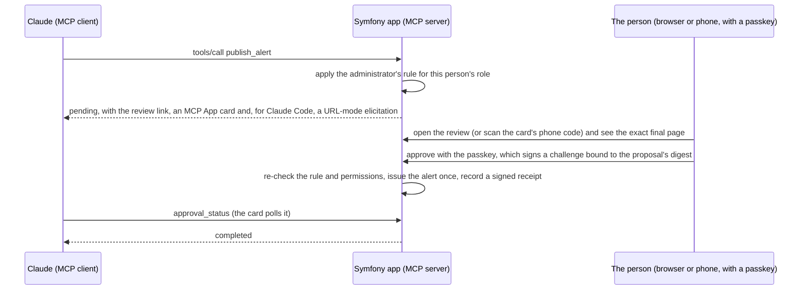

# Verified Human Approval

**An AI agent can ask to put an evacuation order on a council's public alerts page. The application will not let it go live until the right person approves that exact alert with their passkey.**

An agent such as Claude asks for a high-stakes change through MCP. The Symfony application applies its administrator's rule for that person's role: issue directly, verify first, or not at all. When the person must verify, the application freezes the exact proposal and shows it in Claude as an approval card or a native prompt. The person reviews the final public page on the application's own site and approves with a passkey: Touch ID on a Mac, or Face ID on their phone after scanning a code in the card. The application then re-checks the rule and their permissions and makes that stored change once.

**The application enforces this.** Not MCP, not the agent, and not a judgment call in the chat. The rule lives in the application and covers every way in: its own website, any MCP client, any agent. Only the person's passkey, signing the exact proposal, satisfies it. A client saying "accept" never counts as approval, and nothing the agent sends later can change what was approved.

Built with the official PHP MCP SDK (`mcp/sdk`), the Symfony MCP bundle and Symfony AI, on the MCP standard as it is: MCP Apps for the card, URL-mode elicitation for the native prompt and OAuth for remote clients. The packages are named `exact-approval/*` after the guarantee they implement: a person approves one exact action.

## Run it in five minutes

You need PHP 8.3+ with the `pdo_sqlite`, `sodium` and `openssl` extensions, Composer, and Chrome or Safari. To see the Claude side, you also need Claude Desktop or Claude Code.

```bash
git clone https://github.com/scottfalconer/verified-human-approval.git
cd verified-human-approval
composer install
php examples/symfony/bin/setup.php
PHP_CLI_SERVER_WORKERS=4 php -S localhost:8080 -t examples/symfony/public examples/symfony/public/index.php
```

Setup prints fresh passwords, personal agent tokens and one-time passkey links once, plus the exact commands for connecting Claude. The server runs several workers because Claude keeps a connection open while you approve in the browser. If you ran an earlier version, start fresh with `php examples/symfony/bin/setup.php --reset`.

The demo is Riverside Council's public alerts site. Its administrator's rule starts like this:

| Account | Role | Issuing a public alert |
| --- | --- | --- |
| `manager` | Emergency manager, the administrator | Directly |
| `editor` | County staff | Only after approving the exact alert with their own passkey |
| `reader` | Read-only colleague | Not allowed |
| `other` | Another organization | Cannot see these alerts |

1. **Add a passkey.** Open http://localhost:8080, sign in as `editor`, then open the editor's `passkey_link` from setup and register a passkey. On a Mac, Touch ID works. A password alone cannot add an approval passkey: the first one needs this one-time link, and any further one needs an existing passkey.
2. **Connect Claude** as the editor, using the commands setup printed:
   - **Claude Desktop:** add the printed `verified-human-approval` entry under `mcpServers` in `claude_desktop_config.json`, then restart Claude. It uses `mcp-remote`, and keeps the token in a private file.
   - **Claude Code:** run the printed `claude mcp add --transport http …` command.
3. **Ask Claude:** "Issue the Riverside Road evacuation alert."
4. **Approve.** Claude Desktop shows an approval card, and Claude Code shows an "Open link" prompt. Either one opens the review page, which shows the exact alerts page residents will see. Approve with your passkey, and the card updates to show it's done.
5. **Check the result** at http://localhost:8080/alerts. It said "No active alerts" until you approved. Now it shows the alert you approved.

Sign in as `manager`, add the manager's passkey with its link, and open **Administrator settings** to change the rule. You can let staff issue directly, or stop them issuing at all. Changing the rule is itself high-stakes, so proposing a change takes you to a review page, and nothing changes until you approve it with your passkey. Then any request still waiting under the old rule can no longer be approved.

**Audit log**, also for the administrator, shows how every change happened:
- who asked, through which agent;
- under which rule;
- whether a person verified it, and with which passkey.

It re-checks every record each time it opens. It also lists passkeys, agent connections and the signed security log, and can revoke either a passkey or a connection.

To start over for another run, use `php examples/symfony/bin/setup.php --reset`.

On a Mac, `examples/symfony/bin/server start` runs the site under launchd instead, so it keeps running when the terminal or Claude quits. It also takes `stop`, `restart` and `status`.

## claude.ai, and approving on your phone

claude.ai and phones need the site on a public HTTPS address. On a Mac with `cloudflared` installed:

```bash
examples/symfony/bin/public start
```

This opens a Cloudflare quick tunnel and starts a second copy of the demo behind it, under launchd. It prints the public address and the connector URL. The new accounts' passwords are in `var/public-demo-setup.txt`. A quick tunnel gets a new hostname each time it starts, and passkeys belong to a hostname, so a new hostname gets a fresh demo.

1. Open the public address, sign in as `editor`, open the editor's `passkey_link` from `var/public-demo-setup.txt` and add a passkey. With iCloud Keychain or Google Password Manager, the same passkey reaches your phone.
2. In claude.ai, open **Settings → Connectors**, add a custom connector, and paste the printed `https://…/mcp` URL. Claude signs in through the demo's OAuth: sign in as `editor` and allow access.
3. Ask Claude to issue the alert. In the card, **Review and approve** opens the review in a new tab. **Approve on your phone** shows a QR code instead: scan it with the phone's camera, check the alert, and approve with Face ID. The card shows the result either way.

The phone code works once, for two minutes, and opens only that one review. It is not a sign-in: the phone can't reach anything else on the site, and approving still takes the person's own passkey.

To run it again, `examples/symfony/bin/public all-clear` takes the alert down and keeps the accounts, passkeys and the claude.ai connection; the take-down is recorded in the audit log. `examples/symfony/bin/public reset` starts a fresh copy on the same address. Stop it with `examples/symfony/bin/public stop`.

## How it works



- **The administrator sets the rule, per role.** It says which roles act directly, which must verify each exact change, and which may not act. Every proposal records the rule's version, so changing the rule invalidates pending requests. Changing the rule is itself approved with the administrator's passkey.
- **A password is not a passkey.** The first approval passkey needs a one-time link from setup or an administrator; any other needs an existing passkey. Each enrollment is signed into an audit log, and only a passkey with a signed enrollment record can approve.
- **The proposal is frozen.** It holds the exact content, the page layout's version, who asked, the rule and an expiry, all stored as canonical JSON with a SHA-256 digest.
- **The person sees the real page.** The review page renders the site's own template from the frozen proposal, not from the current draft.
- **The site acts, not the client.** Completing the passkey ceremony runs the stored proposal in one database transaction, together with consuming the approval and recording a receipt signed with the application's key.
- **Every record can be checked.** Receipts are signed as the action commits, with a key kept outside the database. The audit page re-checks each one, and re-checks the person's passkey signature against the key they enrolled.
- **Each client gets the way it can show.**
  - Claude Desktop and claude.ai get an MCP App card (`io.modelcontextprotocol/ui`). It opens the review through `ui/open-link`, or shows a one-time code for the phone, and shows only what the site recorded.
  - Claude Code gets a URL-mode elicitation on MCP 2026-07-28. Its retry is bound to the same caller, tool and arguments.
  - Every client gets a plain link.
- **Remote clients sign in with MCP OAuth.** Protected resource metadata, dynamic client registration or client ID metadata documents, PKCE and rotating refresh tokens. An agent's token can ask for an action. It can never approve one.

## What it refuses

| Attempt | Result |
| --- | --- |
| A staff member's agent asks to issue the alert | Pending until that person approves with their passkey. The agent can't skip it |
| A read-only colleague's agent asks | Refused: the rule doesn't let that role issue alerts |
| The administrator changes the rule while a request waits | That request can no longer be approved |
| The draft is edited after you reviewed it | Not issued: the proposal no longer matches |
| The alerts page layout changes after review | Not issued: the layout is part of what you approved |
| A signed approval is replayed for another request | Rejected: the signature covers one proposal's digest |
| A client answers "accept" without your passkey | Still pending: accept only means the page was opened |
| The same approval is repeated | The same receipt, and the alert issued once |
| A phone code is used twice, or after two minutes | Refused: each code works once |
| Someone with only the password tries to add a passkey | Refused: the first needs a one-time link, any other an existing passkey |
| A passkey row is added or changed directly in the database | It approves nothing: no signed enrollment record vouches for it |
| An approval's record is edited in the database afterwards | The audit page's checks fail: the receipt was signed at commit, and the passkey signed the original |
| An administrator's password alone tries to switch verification off | Pending: the rule change waits for the administrator's passkey |
| Another account, or a read-only agent token | No access to the request, and no rights from a passkey |

## What Symfony AI and the PHP MCP SDK made possible

- **The PHP MCP SDK 0.9** serves both protocol eras from one server. That covers the 2025-11-25 handshake and the 2026-07-28 multi round-trip, with signed request state, URL-mode elicitation, the MCP Apps extension and OAuth protected resource metadata.
- **The Symfony MCP bundle's `#[AsMcpApp]`** serves the approval card, and `#[AsMcpAppTool]` gives it app-only tools that the model never sees. Its `#[McpTool]` tools receive the SDK's `RequestContext`.
- **Symfony AI's Agent and McpToolbox** drive the same tools in a scripted example: `php examples/clients/agent.php --scripted`.
- **`web-auth/webauthn-lib`** verifies passkeys with user verification required.

## Packages

| Package | What it does |
| --- | --- |
| [`packages/core`](packages/core) | Frozen proposals, policies, current authority, guarded single execution, receipts signed at commit, the signed audit log and evidence verification |
| [`packages/webauthn`](packages/webauthn/README.md) | Passkey enrollment, assertion verification bound to the proposal, and passkeys anchored to signed enrollment records |
| [`packages/mcp`](packages/mcp/README.md) | The MCP App approval card, the opt-in URL-mode elicitation and its bound retry |
| [`packages/symfony`](packages/symfony/README.md) | The Symfony bundle: review routes, CSRF, rate limits, the card app, the phone code and the status tool |
| [`examples/symfony`](examples/symfony) | The Riverside Council alerts demo: per-role rules, passkey links, the audit page and MCP OAuth |
| [`packages/drupal`](packages/drupal/exact_approval/README.md) | An early Drupal port on the same core. The Symfony bundle is the reference |

## Tests

```bash
composer test        # PHPUnit: core, WebAuthn, Symfony, MCP, OAuth, the phone code and evidence
composer analyse     # PHPStan
PHP_BIN=php python3 tests/http_smoke.py   # the real app and the official SDK over HTTP
```

Optional checks that drive real clients. The browser checks need Python Playwright, and `CHROMIUM_BIN` set to Chrome or Chromium:

- **`tests/browser_smoke.py`** runs real Chrome against the real page scripts, with a virtual passkey.
- **`tests/card_smoke.py`** runs the real approval card in Chrome inside a scripted MCP Apps host, and reads the QR code it draws with a real decoder.
- **`tests/phone_smoke.py`** approves on a "phone": a separate browser that never signed in, behind a stand-in HTTPS tunnel, using a synced copy of the passkey.
- **`tests/claude_code_host.py`** runs the real Claude Code engine, the way the Claude desktop app does. It checks that the native prompt reaches the host, and that after approval the retried call returns the recorded result. It makes one small model call.

## Status

Verified on a Mac with PHP 8.3:
- the PHPUnit suite and PHPStan;
- the HTTP smoke test;
- Chrome with virtual passkeys: the approval flow, the card's phone code, and a phone approval behind a stand-in HTTPS tunnel;
- Claude Code 2.1.317's native prompt end to end;
- the whole flow in a real Claude Desktop chat with Touch ID, on the earlier announcement version of this demo: the card appeared, the review page showed the final page, an iCloud Keychain passkey approved it, the site published once, and the card picked up the result;
- claude.ai through a Cloudflare quick tunnel, with a physical iPhone: claude.ai signed in through the demo's OAuth using Claude's published identity, the card in claude.ai showed the phone code, and the iPhone, never signed in, approved with the synced passkey. The alert was issued once.

Not yet covered: production identity integration.

See the [full overview](docs/overview.md), the [security model](docs/security-model.md) and [evidence verification](docs/evidence.md).

MIT license. See [LICENSE](LICENSE).
